# Part 2: C/HLL control-flow fundamentals

This document studies how each basic C control-flow construct turns into a **control-flow graph (CFG)**. For every
construct it covers:

- the control flow in words;
- the basic blocks, the edges and the branch conditions;
- the loop back edges;
- the **expected CFG**, drawn as a diagram.

Each construct has a regression program in [`regression/c/`](../regression/c). The **expected CFG of every
function** is written down by hand in [`regression/expected/`](../regression/expected).
`tests/test_regression_cfgs.py` then checks that expectation against the CFG that LLVM itself builds from Clang's
`-O0` IR.

> The regression programs are **development and regression cases**. They are **not** a limit on the inputs the
> tool will accept. Constructs not covered yet (`&&`/`||`, `?:`, `switch`, `goto`, …) are listed under **[B3]** in
> [`OPEN_QUESTIONS.md`](OPEN_QUESTIONS.md).

**How to keep this document correct:** the parts between `BEGIN GENERATED` and `END GENERATED` markers (code
listings, diagrams, block and edge tables) are produced from the TOML specs by `cfgverify expected-cfgs`. Edit the
specs, not those parts. The explanatory text around them is written by hand.

---

## 1. Concepts used in every section

### 1.1 Basic block
A basic block is a maximal straight-line sequence of instructions. Control enters only at its **first** instruction
and leaves only at its **last** one (the *terminator*). In LLVM IR every block starts with a label and ends with
exactly one terminator:

| Terminator | Meaning | Edges out |
|---|---|---|
| `br label %X` | unconditional jump | 1, kind **U** |
| `br i1 %c, label %T, label %F` | 2-way branch on the 1-bit value `%c` | 2: **T** (taken when `%c` is true) and **F** |
| `ret …` | return from the function | 0; the block is an **exit** |

A **call** (`call @square(...)`) is *not* a terminator. The callee returns to the next instruction, so a call does not
split a block. We build **one CFG per function** (intraprocedural, [C2]).

### 1.2 Branch conditions
Each C comparison of `int` values becomes one `icmp` instruction whose 1-bit result feeds the `br`:

| C | `<` | `<=` | `>` | `>=` | `==` | `!=` |
|---|---|---|---|---|---|---|
| IR (`int` is signed) | `icmp slt` | `icmp sle` | `icmp sgt` | `icmp sge` | `icmp eq` | `icmp ne` |

Unsigned operands would give `ult`/`ule`/`ugt`/`uge`. `i % k == 0` becomes `srem` followed by `icmp eq`.
Throughout this document, a block that ends in a 2-way branch is called a **decision**.

### 1.3 Back edges and loops
- Block **d dominates** block n if every path from `entry` to n passes through d.
- A **back edge** is an edge t → h where **h dominates t**. It is the edge that closes a loop. h is the
  **loop header** and t is a **latch**.
- The **natural loop** of header h is h plus every block that can reach a latch without passing through h.
  Loops that share a header are merged into one natural loop.
- The **depth** of a loop is how many natural loops contain its header (1 = outermost).

These are the standard definitions. `src/cfgverify/graph_utils.py` computes them, and the tests compare them against
the specs.

### 1.4 Counting
- **Cyclomatic complexity** = E − N + 2 (E edges, N blocks).
- When every block has 0, 1 or 2 successors and there is exactly one exit block (true for every function
  here), cyclomatic complexity = **decisions + 1**.

### 1.5 How Clang `-O0` names blocks

| Construct | Blocks Clang creates |
|---|---|
| `if` | `if.then`, `if.else`, `if.end` (the join) |
| `while` | `while.cond`, `while.body`, `while.end` |
| `for` | `for.cond`, `for.body`, `for.inc` (the step), `for.end` |
| `do-while` | `do.body`, `do.cond`, `do.end` |
| several `return`s | one shared `return` block that returns the `%retval` slot |

When a name repeats, LLVM adds a number (`if.then2`, `for.cond1`, `if.end8`, …). The number comes from a
per-function counter, **not** from the nesting level. Block names are only there for readability. **Matching must
never depend on block names**; see §5 for a misleading example.

### 1.6 How to read the diagrams
| Mark | Meaning |
|---|---|
| thick border | `entry` block |
| double border | exit block (ends in `ret`) |
| yellow fill | decision (2-way branch) |
| blue fill | loop header |
| green / red edge | **T** / **F** edge of a decision |
| grey edge | **U** (unconditional) edge |
| dashed blue edge | back edge |

`L9–10: …` is the source lines and statements that run in the block. Clang sometimes also attaches the loop's line
to a latch's jump or a closing brace's line to a trailing jump. We list only the lines where the statement's
actual work happens.

---

## 2. Sequential statements (`sequence.c`)

**Control flow.** Statements run one after another. There are no decisions, so the whole function body is **one
basic block**, ending in `ret`. The calls to `square` stay inside that block. `square` has its own CFG, which is
also a single block.

```
[entry: s1; s2; ...; return]
```

<!-- BEGIN GENERATED cfg: sequence.c/square -->
**`square`**: `regression/c/sequence.c`, lines 8–10

```c
 8  int square(int x) {
 9      return x * x;
10  }
```

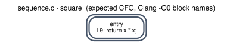

| Block | Lines | What runs there | Leaves by |
|---|---|---|---|
| `entry` | 9 | `return x * x;` | return |

_No edges: the whole function is one basic block._

Blocks **1** · edges **0** · decisions **0** · cyclomatic **1** · back edges: none · loops: none
<!-- END GENERATED cfg: sequence.c/square -->

<!-- BEGIN GENERATED cfg: sequence.c/sequence -->
**`sequence`**: `regression/c/sequence.c`, lines 12–17

```c
12  int sequence(int a, int b) {
13      int sum = a + b;
14      int diff = a - b;
15      int result = square(sum) - square(diff);
16      return result;
17  }
```

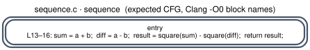

| Block | Lines | What runs there | Leaves by |
|---|---|---|---|
| `entry` | 13–16 | `sum = a + b;  diff = a - b;  result = square(sum) - square(diff);  return result;` | return |

_No edges: the whole function is one basic block._

Blocks **1** · edges **0** · decisions **0** · cyclomatic **1** · back edges: none · loops: none
<!-- END GENERATED cfg: sequence.c/sequence -->

---

## 3. `if` without `else` (`if.c`)

**Control flow.** The condition is evaluated at the end of the block before the `if`. If it is true (**T**) the
then-block runs and then jumps to the join block. If it is false (**F**), control goes **straight to the join
block**, so there is no else-block. The F edge "skips" the then-block.

```
        [cond]
       T/    \F
    [then]    |
       \     /
       [join]
```

<!-- BEGIN GENERATED cfg: if.c/clamp_negative -->
**`clamp_negative`**: `regression/c/if.c`, lines 8–13

```c
 8  int clamp_negative(int x) {
 9      int y = x;
10      if (x < 0)
11          y = 0;
12      return y;
13  }
```

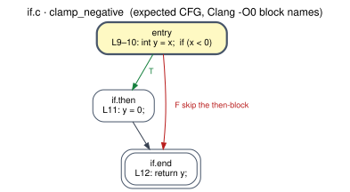

| Block | Lines | What runs there | Leaves by |
|---|---|---|---|
| `entry` | 9–10 | `int y = x;  if (x < 0)` | 2-way branch on `x < 0` (`icmp slt`) |
| `if.then` | 11 | `y = 0;` | jump |
| `if.end` | 12 | `return y;` | return |

| Edge | Kind | Taken when |
|---|---|---|
| `entry → if.then` | T | `x < 0` is true |
| `entry → if.end` | F | `x < 0` is false: **skip the then-block** |
| `if.then → if.end` | U | always |

Blocks **3** · edges **3** · decisions **1** · cyclomatic **2** · back edges: none · loops: none
<!-- END GENERATED cfg: if.c/clamp_negative -->

### 3.1 `return`: early return (`if.c`, `safe_div`)

**Control flow.** `return` ends the function immediately. Everything after the `if` then runs only when the
condition is false, so an early return turns the rest of the function into an **implicit else**.

How Clang `-O0` builds it:
- **one** exit block, named `return`;
- each `return e;` statement stores `e` into a stack slot `%retval` and jumps to `return`;
- that block loads `%retval` and executes the function's **only** `ret`.

The result is the same diamond shape as an if-else (§4), even though the C source has two `return` statements.

<!-- BEGIN GENERATED cfg: if.c/safe_div -->
**`safe_div`**: `regression/c/if.c`, lines 15–19

```c
15  int safe_div(int a, int b) {
16      if (b == 0)
17          return 0;
18      return a / b;
19  }
```

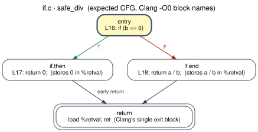

| Block | Lines | What runs there | Leaves by |
|---|---|---|---|
| `entry` | 16 | `if (b == 0)` | 2-way branch on `b == 0` (`icmp eq`) |
| `if.then` | 17 | `return 0;  (stores 0 in %retval)` | jump |
| `if.end` | 18 | `return a / b;  (stores a / b in %retval)` | jump |
| `return` | — | `load %retval; ret  (Clang's single exit block)` | return |

| Edge | Kind | Taken when |
|---|---|---|
| `entry → if.then` | T | `b == 0` is true |
| `entry → if.end` | F | `b == 0` is false |
| `if.then → return` | U | always: **early return** |
| `if.end → return` | U | always |

Blocks **4** · edges **4** · decisions **1** · cyclomatic **2** · back edges: none · loops: none
<!-- END GENERATED cfg: if.c/safe_div -->

---

## 4. `if-else` and `else if` chains (`if_else.c`)

**Control flow.** Exactly one of the two arms runs. Both arms end with a jump to the join block. The result is the
classic **diamond**:

```
        [cond]
       T/    \F
    [then]  [else]
       \     /
       [join]
```

<!-- BEGIN GENERATED cfg: if_else.c/max2 -->
**`max2`**: `regression/c/if_else.c`, lines 8–15

```c
 8  int max2(int a, int b) {
 9      int m;
10      if (a > b)
11          m = a;
12      else
13          m = b;
14      return m;
15  }
```

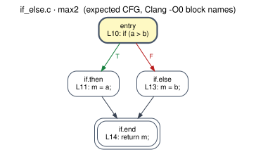

| Block | Lines | What runs there | Leaves by |
|---|---|---|---|
| `entry` | 10 | `if (a > b)` | 2-way branch on `a > b` (`icmp sgt`) |
| `if.then` | 11 | `m = a;` | jump |
| `if.else` | 13 | `m = b;` | jump |
| `if.end` | 14 | `return m;` | return |

| Edge | Kind | Taken when |
|---|---|---|
| `entry → if.then` | T | `a > b` is true |
| `entry → if.else` | F | `a > b` is false |
| `if.then → if.end` | U | always |
| `if.else → if.end` | U | always |

Blocks **4** · edges **4** · decisions **1** · cyclomatic **2** · back edges: none · loops: none
<!-- END GENERATED cfg: if_else.c/max2 -->

**`else if` is not a separate construct.** It is an `if-else` nested inside the else-arm of the outer `if`. The inner
`if-else` gets its own join block (`if.end` below), which contains nothing but a jump to the outer join (`if.end4`).
Such **jump-only blocks** are the first thing normalization has to remove (rule N2).

<!-- BEGIN GENERATED cfg: if_else.c/sign -->
**`sign`**: `regression/c/if_else.c`, lines 17–26

```c
17  int sign(int x) {
18      int s;
19      if (x > 0)
20          s = 1;
21      else if (x < 0)
22          s = -1;
23      else
24          s = 0;
25      return s;
26  }
```

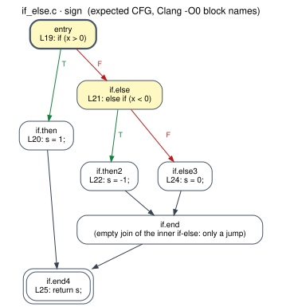

| Block | Lines | What runs there | Leaves by |
|---|---|---|---|
| `entry` | 19 | `if (x > 0)` | 2-way branch on `x > 0` (`icmp sgt`) |
| `if.then` | 20 | `s = 1;` | jump |
| `if.else` | 21 | `else if (x < 0)` | 2-way branch on `x < 0` (`icmp slt`) |
| `if.then2` | 22 | `s = -1;` | jump |
| `if.else3` | 24 | `s = 0;` | jump |
| `if.end` | — | `(empty join of the inner if-else: only a jump)` | jump |
| `if.end4` | 25 | `return s;` | return |

| Edge | Kind | Taken when |
|---|---|---|
| `entry → if.then` | T | `x > 0` is true |
| `entry → if.else` | F | `x > 0` is false |
| `if.then → if.end4` | U | always |
| `if.else → if.then2` | T | `x < 0` is true |
| `if.else → if.else3` | F | `x < 0` is false |
| `if.then2 → if.end` | U | always |
| `if.else3 → if.end` | U | always |
| `if.end → if.end4` | U | always |

Blocks **7** · edges **8** · decisions **2** · cyclomatic **3** · back edges: none · loops: none
<!-- END GENERATED cfg: if_else.c/sign -->

---

## 5. Nested `if` (`nested_if.c`)

**Control flow.** An inner `if-else` sits completely inside one arm of an outer `if-else`. The inner diamond replaces
the "arm" box of the outer diamond. Each `if-else` has its own join block. The inner joins (`if.end`, `if.end7`) only
jump to the outer join (`if.end8`).

**The names are misleading.** `if.else` belongs to the **inner** `if` of the then-arm, while `if.else3` is the
**outer** else. This is why matching must use graph structure and never names.

<!-- BEGIN GENERATED cfg: nested_if.c/quadrant -->
**`quadrant`**: `regression/c/nested_if.c`, lines 8–22

```c
 8  int quadrant(int x, int y) {
 9      int q;
10      if (x >= 0) {
11          if (y >= 0)
12              q = 1;
13          else
14              q = 4;
15      } else {
16          if (y >= 0)
17              q = 2;
18          else
19              q = 3;
20      }
21      return q;
22  }
```

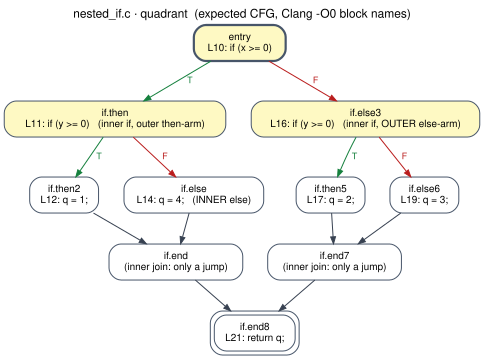

| Block | Lines | What runs there | Leaves by |
|---|---|---|---|
| `entry` | 10 | `if (x >= 0)` | 2-way branch on `x >= 0` (`icmp sge`) |
| `if.then` | 11 | `if (y >= 0)   (inner if, outer then-arm)` | 2-way branch on `y >= 0` (`icmp sge`) |
| `if.then2` | 12 | `q = 1;` | jump |
| `if.else` | 14 | `q = 4;   (INNER else)` | jump |
| `if.end` | — | `(inner join: only a jump)` | jump |
| `if.else3` | 16 | `if (y >= 0)   (inner if, OUTER else-arm)` | 2-way branch on `y >= 0` (`icmp sge`) |
| `if.then5` | 17 | `q = 2;` | jump |
| `if.else6` | 19 | `q = 3;` | jump |
| `if.end7` | — | `(inner join: only a jump)` | jump |
| `if.end8` | 21 | `return q;` | return |

| Edge | Kind | Taken when |
|---|---|---|
| `entry → if.then` | T | `x >= 0` is true |
| `entry → if.else3` | F | `x >= 0` is false |
| `if.then → if.then2` | T | `y >= 0` is true |
| `if.then → if.else` | F | `y >= 0` is false |
| `if.then2 → if.end` | U | always |
| `if.else → if.end` | U | always |
| `if.end → if.end8` | U | always |
| `if.else3 → if.then5` | T | `y >= 0` is true |
| `if.else3 → if.else6` | F | `y >= 0` is false |
| `if.then5 → if.end7` | U | always |
| `if.else6 → if.end7` | U | always |
| `if.end7 → if.end8` | U | always |

Blocks **10** · edges **12** · decisions **3** · cyclomatic **4** · back edges: none · loops: none
<!-- END GENERATED cfg: nested_if.c/quadrant -->

---

## 6. `while` loop (`while.c`)

**Control flow.** The condition is tested **before** every iteration, so the body can run **zero** times.

- The condition gets its own block (`while.cond`), which is the **loop header**.
- The body ends with a jump back to the condition. That jump is the **back edge** (`while.body → while.cond`).
- The F edge of the condition is the loop's only exit.
- The edge `entry → while.cond` also enters the header, but it is *not* a back edge, because `while.cond` does not
  dominate `entry`.

```
  [pre] ──► [cond] ──F──► [exit]
             ▲  │T
       back  │  ▼
             └─[body]
```

<!-- BEGIN GENERATED cfg: while.c/sum_to -->
**`sum_to`**: `regression/c/while.c`, lines 8–16

```c
 8  int sum_to(int n) {
 9      int sum = 0;
10      int i = 1;
11      while (i <= n) {
12          sum += i;
13          i++;
14      }
15      return sum;
16  }
```

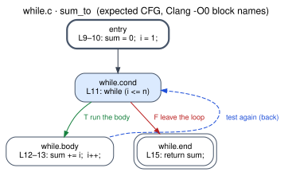

| Block | Lines | What runs there | Leaves by |
|---|---|---|---|
| `entry` | 9–10 | `sum = 0;  i = 1;` | jump |
| `while.cond` | 11 | `while (i <= n)` | 2-way branch on `i <= n` (`icmp sle`) |
| `while.body` | 12–13 | `sum += i;  i++;` | jump |
| `while.end` | 15 | `return sum;` | return |

| Edge | Kind | Taken when |
|---|---|---|
| `entry → while.cond` | U | always |
| `while.cond → while.body` | T | `i <= n` is true: **run the body** |
| `while.cond → while.end` | F | `i <= n` is false: **leave the loop** |
| `while.body → while.cond` | U, **back edge** | always: **test again** |

Blocks **4** · edges **4** · decisions **1** · cyclomatic **2** · back edges: `while.body → while.cond` · loops: header `while.cond` (depth 1) = {while.cond, while.body}
<!-- END GENERATED cfg: while.c/sum_to -->

---

## 7. `for` loop (`for.c`)

**Control flow.** `for (init; cond; step) body` behaves like `init; while (cond) { body; step; }`.

- `init` runs once, in the block before the loop.
- `cond` is the header (`for.cond`).
- `step` gets its **own block** (`for.inc`). That block is the latch, and it is also where `continue` jumps (§11).
- The back edge is `for.inc → for.cond`.

```
  [init] ──► [cond] ──F──► [exit]
              ▲  │T
        back  │  ▼
           [step] ◄── [body]
```

<!-- BEGIN GENERATED cfg: for.c/factorial -->
**`factorial`**: `regression/c/for.c`, lines 8–13

```c
 8  int factorial(int n) {
 9      int f = 1;
10      for (int i = 2; i <= n; i++)
11          f *= i;
12      return f;
13  }
```

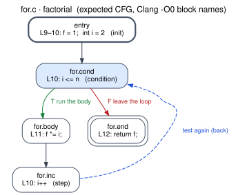

| Block | Lines | What runs there | Leaves by |
|---|---|---|---|
| `entry` | 9–10 | `f = 1;  int i = 2   (init)` | jump |
| `for.cond` | 10 | `i <= n   (condition)` | 2-way branch on `i <= n` (`icmp sle`) |
| `for.body` | 11 | `f *= i;` | jump |
| `for.inc` | 10 | `i++   (step)` | jump |
| `for.end` | 12 | `return f;` | return |

| Edge | Kind | Taken when |
|---|---|---|
| `entry → for.cond` | U | always |
| `for.cond → for.body` | T | `i <= n` is true: **run the body** |
| `for.cond → for.end` | F | `i <= n` is false: **leave the loop** |
| `for.body → for.inc` | U | always |
| `for.inc → for.cond` | U, **back edge** | always: **test again** |

Blocks **5** · edges **5** · decisions **1** · cyclomatic **2** · back edges: `for.inc → for.cond` · loops: header `for.cond` (depth 1) = {for.cond, for.body, for.inc}
<!-- END GENERATED cfg: for.c/factorial -->

---

## 8. `do-while` loop (`do_while.c`)

**Control flow.** The body runs **first**, and the condition is tested **after** each iteration, so the body runs
**at least once**.

- `entry` jumps straight into the body.
- The header is the **body** (`do.body`).
- The condition block `do.cond` sits at the bottom. It is both the latch and the loop exit.
- Its **T** edge is the back edge (`do.cond → do.body`).

Compare this with `while`: there the header is the condition and the latch is an unconditional jump. Here the
latch is a decision.

```
  [pre] ──► [body] ◄──┐
              │       │ T (back)
              ▼       │
            [cond] ───┘
              │F
            [exit]
```

<!-- BEGIN GENERATED cfg: do_while.c/count_digits -->
**`count_digits`**: `regression/c/do_while.c`, lines 8–15

```c
 8  int count_digits(int n) {
 9      int digits = 0;
10      do {
11          digits++;
12          n /= 10;
13      } while (n != 0);
14      return digits;
15  }
```

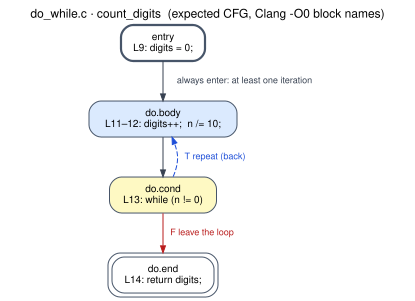

| Block | Lines | What runs there | Leaves by |
|---|---|---|---|
| `entry` | 9 | `digits = 0;` | jump |
| `do.body` | 11–12 | `digits++;  n /= 10;` | jump |
| `do.cond` | 13 | `while (n != 0)` | 2-way branch on `n != 0` (`icmp ne`) |
| `do.end` | 14 | `return digits;` | return |

| Edge | Kind | Taken when |
|---|---|---|
| `entry → do.body` | U | always: **always enter: at least one iteration** |
| `do.body → do.cond` | U | always |
| `do.cond → do.body` | T, **back edge** | `n != 0` is true: **repeat** |
| `do.cond → do.end` | F | `n != 0` is false: **leave the loop** |

Blocks **4** · edges **4** · decisions **1** · cyclomatic **2** · back edges: `do.cond → do.body` · loops: header `do.body` (depth 1) = {do.body, do.cond}
<!-- END GENERATED cfg: do_while.c/count_digits -->

---

## 9. Nested loops (`nested_loop.c`)

**Control flow.** The inner loop lies completely inside the outer loop's body. For every outer iteration, the inner
loop starts again from its `init` (`for.body`: `j = 0`).

- There are **two back edges**, one per loop.
- The inner loop's natural loop is contained in the outer one's, so the inner loop has **depth 2**.
- When the inner loop exits, it goes to `for.end`. That block only jumps to the **outer** step (`for.inc5`).
- The whole function still has a single exit.

<!-- BEGIN GENERATED cfg: nested_loop.c/count_pairs -->
**`count_pairs`**: `regression/c/nested_loop.c`, lines 9–17

```c
 9  int count_pairs(int n) {
10      int count = 0;
11      for (int i = 0; i < n; i++) {
12          for (int j = 0; j < i; j++) {
13              count++;
14          }
15      }
16      return count;
17  }
```

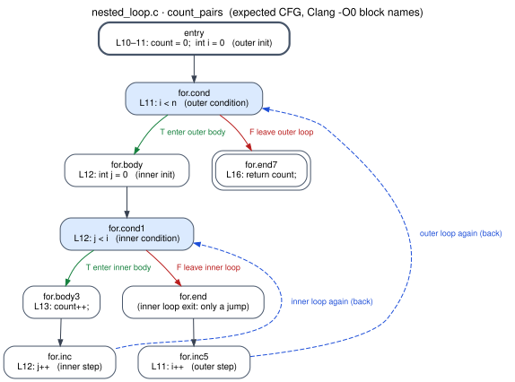

| Block | Lines | What runs there | Leaves by |
|---|---|---|---|
| `entry` | 10–11 | `count = 0;  int i = 0   (outer init)` | jump |
| `for.cond` | 11 | `i < n   (outer condition)` | 2-way branch on `i < n` (`icmp slt`) |
| `for.body` | 12 | `int j = 0   (inner init)` | jump |
| `for.cond1` | 12 | `j < i   (inner condition)` | 2-way branch on `j < i` (`icmp slt`) |
| `for.body3` | 13 | `count++;` | jump |
| `for.inc` | 12 | `j++   (inner step)` | jump |
| `for.end` | — | `(inner loop exit: only a jump)` | jump |
| `for.inc5` | 11 | `i++   (outer step)` | jump |
| `for.end7` | 16 | `return count;` | return |

| Edge | Kind | Taken when |
|---|---|---|
| `entry → for.cond` | U | always |
| `for.cond → for.body` | T | `i < n` is true: **enter outer body** |
| `for.cond → for.end7` | F | `i < n` is false: **leave outer loop** |
| `for.body → for.cond1` | U | always |
| `for.cond1 → for.body3` | T | `j < i` is true: **enter inner body** |
| `for.cond1 → for.end` | F | `j < i` is false: **leave inner loop** |
| `for.body3 → for.inc` | U | always |
| `for.inc → for.cond1` | U, **back edge** | always: **inner loop again** |
| `for.end → for.inc5` | U | always |
| `for.inc5 → for.cond` | U, **back edge** | always: **outer loop again** |

Blocks **9** · edges **10** · decisions **2** · cyclomatic **3** · back edges: `for.inc → for.cond1`, `for.inc5 → for.cond` · loops: header `for.cond` (depth 1) = {for.cond, for.body, for.cond1, for.body3, for.inc, for.end, for.inc5}; header `for.cond1` (depth 2) = {for.cond1, for.body3, for.inc}
<!-- END GENERATED cfg: nested_loop.c/count_pairs -->

---

## 10. `break` (`break.c`)

**Control flow.** `break` is an unconditional jump to the exit block of the **innermost** enclosing loop (`for.end`,
`while.end`). Three consequences are visible in the graphs below:

1. **The loop gets a second exit.** In `first_multiple`, `for.end` can be reached from `for.cond` (F, the loop ran to
   completion) *and* from `if.then` (the `break`). The block that executes `break` (`if.then`) is **not** part of the
   natural loop, because it cannot reach the latch `for.inc`. It is on the way out.
2. **`while (1)` has no condition block.** Clang folds the constant condition even at `-O0`: `entry` jumps straight
   into `while.body`, which becomes the loop header. The `break` is the **only** way out (`halvings`). As a result the
   source has two conditions but the CFG has only one decision.
3. **`break` leaves only the innermost loop.** In `capped_pairs` the `break` jumps to the inner loop's exit
   `for.end`. From there control continues with the **outer** loop's step `for.inc6`.

<!-- BEGIN GENERATED cfg: break.c/first_multiple -->
**`first_multiple`**: `regression/c/break.c`, lines 12–21

```c
12  int first_multiple(int n, int k) {
13      int found = -1;
14      for (int i = 1; i <= n; i++) {
15          if (i % k == 0) {
16              found = i;
17              break;
18          }
19      }
20      return found;
21  }
```

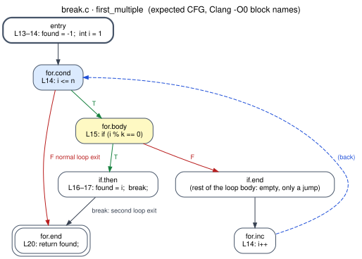

| Block | Lines | What runs there | Leaves by |
|---|---|---|---|
| `entry` | 13–14 | `found = -1;  int i = 1` | jump |
| `for.cond` | 14 | `i <= n` | 2-way branch on `i <= n` (`icmp sle`) |
| `for.body` | 15 | `if (i % k == 0)` | 2-way branch on `i % k == 0` (`icmp eq`) |
| `if.then` | 16–17 | `found = i;  break;` | jump |
| `if.end` | — | `(rest of the loop body: empty, only a jump)` | jump |
| `for.inc` | 14 | `i++` | jump |
| `for.end` | 20 | `return found;` | return |

| Edge | Kind | Taken when |
|---|---|---|
| `entry → for.cond` | U | always |
| `for.cond → for.body` | T | `i <= n` is true |
| `for.cond → for.end` | F | `i <= n` is false: **normal loop exit** |
| `for.body → if.then` | T | `i % k == 0` is true |
| `for.body → if.end` | F | `i % k == 0` is false |
| `if.then → for.end` | U | always: **break: second loop exit** |
| `if.end → for.inc` | U | always |
| `for.inc → for.cond` | U, **back edge** | always |

Blocks **7** · edges **8** · decisions **2** · cyclomatic **3** · back edges: `for.inc → for.cond` · loops: header `for.cond` (depth 1) = {for.cond, for.body, if.end, for.inc}
<!-- END GENERATED cfg: break.c/first_multiple -->

<!-- BEGIN GENERATED cfg: break.c/halvings -->
**`halvings`**: `regression/c/break.c`, lines 24–33

```c
24  int halvings(int n) {
25      int steps = 0;
26      while (1) {
27          if (n <= 1)
28              break;
29          n = n / 2;
30          steps++;
31      }
32      return steps;
33  }
```

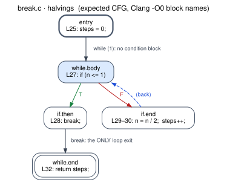

| Block | Lines | What runs there | Leaves by |
|---|---|---|---|
| `entry` | 25 | `steps = 0;` | jump |
| `while.body` | 27 | `if (n <= 1)` | 2-way branch on `n <= 1` (`icmp sle`) |
| `if.then` | 28 | `break;` | jump |
| `if.end` | 29–30 | `n = n / 2;  steps++;` | jump |
| `while.end` | 32 | `return steps;` | return |

| Edge | Kind | Taken when |
|---|---|---|
| `entry → while.body` | U | always: **while (1): no condition block** |
| `while.body → if.then` | T | `n <= 1` is true |
| `while.body → if.end` | F | `n <= 1` is false |
| `if.then → while.end` | U | always: **break: the ONLY loop exit** |
| `if.end → while.body` | U, **back edge** | always |

Blocks **5** · edges **5** · decisions **1** · cyclomatic **2** · back edges: `if.end → while.body` · loops: header `while.body` (depth 1) = {while.body, if.end}
<!-- END GENERATED cfg: break.c/halvings -->

<!-- BEGIN GENERATED cfg: break.c/capped_pairs -->
**`capped_pairs`**: `regression/c/break.c`, lines 36–46

```c
36  int capped_pairs(int n) {
37      int count = 0;
38      for (int i = 0; i < n; i++) {
39          for (int j = 0; j < n; j++) {
40              if (j > i)
41                  break;
42              count++;
43          }
44      }
45      return count;
46  }
```

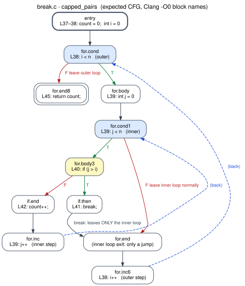

| Block | Lines | What runs there | Leaves by |
|---|---|---|---|
| `entry` | 37–38 | `count = 0;  int i = 0` | jump |
| `for.cond` | 38 | `i < n   (outer)` | 2-way branch on `i < n` (`icmp slt`) |
| `for.body` | 39 | `int j = 0` | jump |
| `for.cond1` | 39 | `j < n   (inner)` | 2-way branch on `j < n` (`icmp slt`) |
| `for.body3` | 40 | `if (j > i)` | 2-way branch on `j > i` (`icmp sgt`) |
| `if.then` | 41 | `break;` | jump |
| `if.end` | 42 | `count++;` | jump |
| `for.inc` | 39 | `j++   (inner step)` | jump |
| `for.end` | — | `(inner loop exit: only a jump)` | jump |
| `for.inc6` | 38 | `i++   (outer step)` | jump |
| `for.end8` | 45 | `return count;` | return |

| Edge | Kind | Taken when |
|---|---|---|
| `entry → for.cond` | U | always |
| `for.cond → for.body` | T | `i < n` is true |
| `for.cond → for.end8` | F | `i < n` is false: **leave outer loop** |
| `for.body → for.cond1` | U | always |
| `for.cond1 → for.body3` | T | `j < n` is true |
| `for.cond1 → for.end` | F | `j < n` is false: **leave inner loop normally** |
| `for.body3 → if.then` | T | `j > i` is true |
| `for.body3 → if.end` | F | `j > i` is false |
| `if.then → for.end` | U | always: **break: leaves ONLY the inner loop** |
| `if.end → for.inc` | U | always |
| `for.inc → for.cond1` | U, **back edge** | always |
| `for.end → for.inc6` | U | always |
| `for.inc6 → for.cond` | U, **back edge** | always |

Blocks **11** · edges **13** · decisions **3** · cyclomatic **4** · back edges: `for.inc → for.cond1`, `for.inc6 → for.cond` · loops: header `for.cond` (depth 1) = {for.cond, for.body, for.cond1, for.body3, if.then, if.end, for.inc, for.end, for.inc6}; header `for.cond1` (depth 2) = {for.cond1, for.body3, if.end, for.inc}
<!-- END GENERATED cfg: break.c/capped_pairs -->

---

## 11. `continue` (`continue.c`)

**Control flow.** `continue` skips the rest of the current iteration and jumps to the loop's *continue target*:

| Loop | `continue` jumps to |
|---|---|
| `for` | the **step** block (`for.inc`), so `i++` still runs |
| `while` | the **condition** block (`while.cond`) |
| `do-while` | the **condition** block (`do.cond`) |

- **In a `for` loop** (`sum_odd`), `if.then` (`continue`) and `if.end` (`sum += i`) both jump to `for.inc`. The loop
  still has exactly one back edge.
- **In a `while` loop** (`count_nonmultiples`), the `continue` jump goes directly to the header. That makes it
  **a second back edge**: one loop, one header, two latches. When counting loops, count **headers** (natural
  loops), not back edges.

<!-- BEGIN GENERATED cfg: continue.c/sum_odd -->
**`sum_odd`**: `regression/c/continue.c`, lines 11–19

```c
11  int sum_odd(int n) {
12      int sum = 0;
13      for (int i = 1; i <= n; i++) {
14          if (i % 2 == 0)
15              continue;
16          sum += i;
17      }
18      return sum;
19  }
```

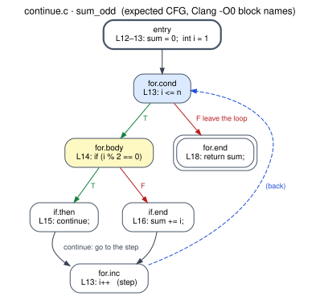

| Block | Lines | What runs there | Leaves by |
|---|---|---|---|
| `entry` | 12–13 | `sum = 0;  int i = 1` | jump |
| `for.cond` | 13 | `i <= n` | 2-way branch on `i <= n` (`icmp sle`) |
| `for.body` | 14 | `if (i % 2 == 0)` | 2-way branch on `i % 2 == 0` (`icmp eq`) |
| `if.then` | 15 | `continue;` | jump |
| `if.end` | 16 | `sum += i;` | jump |
| `for.inc` | 13 | `i++   (step)` | jump |
| `for.end` | 18 | `return sum;` | return |

| Edge | Kind | Taken when |
|---|---|---|
| `entry → for.cond` | U | always |
| `for.cond → for.body` | T | `i <= n` is true |
| `for.cond → for.end` | F | `i <= n` is false: **leave the loop** |
| `for.body → if.then` | T | `i % 2 == 0` is true |
| `for.body → if.end` | F | `i % 2 == 0` is false |
| `if.then → for.inc` | U | always: **continue: go to the step** |
| `if.end → for.inc` | U | always |
| `for.inc → for.cond` | U, **back edge** | always |

Blocks **7** · edges **8** · decisions **2** · cyclomatic **3** · back edges: `for.inc → for.cond` · loops: header `for.cond` (depth 1) = {for.cond, for.body, if.then, if.end, for.inc}
<!-- END GENERATED cfg: continue.c/sum_odd -->

<!-- BEGIN GENERATED cfg: continue.c/count_nonmultiples -->
**`count_nonmultiples`**: `regression/c/continue.c`, lines 22–32

```c
22  int count_nonmultiples(int n, int k) {
23      int count = 0;
24      int i = 0;
25      while (i < n) {
26          i++;
27          if (i % k == 0)
28              continue;
29          count++;
30      }
31      return count;
32  }
```

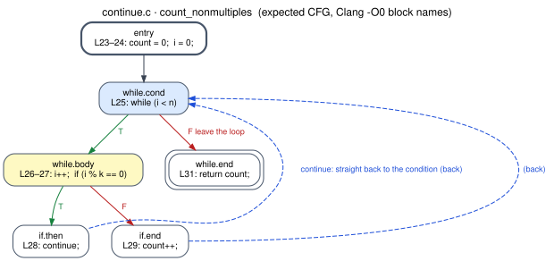

| Block | Lines | What runs there | Leaves by |
|---|---|---|---|
| `entry` | 23–24 | `count = 0;  i = 0;` | jump |
| `while.cond` | 25 | `while (i < n)` | 2-way branch on `i < n` (`icmp slt`) |
| `while.body` | 26–27 | `i++;  if (i % k == 0)` | 2-way branch on `i % k == 0` (`icmp eq`) |
| `if.then` | 28 | `continue;` | jump |
| `if.end` | 29 | `count++;` | jump |
| `while.end` | 31 | `return count;` | return |

| Edge | Kind | Taken when |
|---|---|---|
| `entry → while.cond` | U | always |
| `while.cond → while.body` | T | `i < n` is true |
| `while.cond → while.end` | F | `i < n` is false: **leave the loop** |
| `while.body → if.then` | T | `i % k == 0` is true |
| `while.body → if.end` | F | `i % k == 0` is false |
| `if.then → while.cond` | U, **back edge** | always: **continue: straight back to the condition** |
| `if.end → while.cond` | U, **back edge** | always |

Blocks **6** · edges **7** · decisions **2** · cyclomatic **3** · back edges: `if.end → while.cond`, `if.then → while.cond` · loops: header `while.cond` (depth 1) = {while.cond, while.body, if.then, if.end}
<!-- END GENERATED cfg: continue.c/count_nonmultiples -->

---

## 12. Summary of all regression functions

<!-- BEGIN GENERATED cfg: summary/all -->
| Program | Function | Blocks | Edges | Decisions | Cyclomatic | Back edges | Loops (header: depth) |
|---|---|---|---|---|---|---|---|
| `sequence.c` | `square` | 1 | 0 | 0 | 1 | 0 | — |
| `sequence.c` | `sequence` | 1 | 0 | 0 | 1 | 0 | — |
| `if.c` | `clamp_negative` | 3 | 3 | 1 | 2 | 0 | — |
| `if.c` | `safe_div` | 4 | 4 | 1 | 2 | 0 | — |
| `if_else.c` | `max2` | 4 | 4 | 1 | 2 | 0 | — |
| `if_else.c` | `sign` | 7 | 8 | 2 | 3 | 0 | — |
| `nested_if.c` | `quadrant` | 10 | 12 | 3 | 4 | 0 | — |
| `while.c` | `sum_to` | 4 | 4 | 1 | 2 | 1 | `while.cond`: 1 |
| `for.c` | `factorial` | 5 | 5 | 1 | 2 | 1 | `for.cond`: 1 |
| `do_while.c` | `count_digits` | 4 | 4 | 1 | 2 | 1 | `do.body`: 1 |
| `nested_loop.c` | `count_pairs` | 9 | 10 | 2 | 3 | 2 | `for.cond`: 1, `for.cond1`: 2 |
| `break.c` | `first_multiple` | 7 | 8 | 2 | 3 | 1 | `for.cond`: 1 |
| `break.c` | `halvings` | 5 | 5 | 1 | 2 | 1 | `while.body`: 1 |
| `break.c` | `capped_pairs` | 11 | 13 | 3 | 4 | 2 | `for.cond`: 1, `for.cond1`: 2 |
| `continue.c` | `sum_odd` | 7 | 8 | 2 | 3 | 1 | `for.cond`: 1 |
| `continue.c` | `count_nonmultiples` | 6 | 7 | 2 | 3 | 2 | `while.cond`: 1 |
<!-- END GENERATED cfg: summary/all -->

---

## 13. Observations that matter for later parts

These come from the programs above. Each one is checked by the tests, except where marked.

| # | Observation | Consequence for the design |
|---|---|---|
| O1 | Clang `-O0` produces **jump-only blocks**: `if.end` in `sign` and `quadrant`, the inner `for.end` in the nested loops, the empty `if.end` in `first_multiple`, and the blocks that contain only `break;` or `continue;`. | Normalization rule **N2** (jump-only bypass) is needed on the HLL side. Removing a jump-only block can leave a branch whose two targets are the same block, which rule **N5** handles. |
| O2 | Several `return` statements still give **one** `ret` (Clang's shared `return` block). | Assembly may have one epilogue or several. Rule **N4** (single virtual EXIT) makes the two sides comparable. |
| O3 | An early return has the same CFG shape as an if-else. | This is correct and expected: the structure really is the same. |
| O4 | Block names don't reflect structure (`if.else` vs `if.else3` in `quadrant`). | Matching uses structure only. Names appear only in evidence and explanations. |
| O5 | `while (1)` has no condition block, because Clang folds constant conditions even at `-O0`. | A CFG can have fewer decisions than the source has conditions. Invariants must be computed on the CFG, not on the source text. |
| O6 | `continue` in a `while` loop creates a second back edge into the same header. | The L1 invariant "number of loops" must count **natural loops (headers)**, not back edges. |
| O7 | The block that executes `break` is outside the natural loop. | Loop membership in the CFG is not the same as the loop's braces in the source. Explanations should take care when they say "inside the loop". |
| O8 | Clang marks each latch's jump with `!llvm.loop` metadata. *(Observed, not tested.)* | This is a hint only. Loops are found with dominators so that the assembly side, which has no such metadata, is treated the same way. |
| O9 | For all 10 programs, the IR CFG is **identical** for x86-64, i686, AArch64, ARMv7, RISC-V 64 and MIPS target triples. | This supports **[A7]** (generating IR for the confirmed target costs nothing for this subset). It says **nothing** about the assembly CFGs, which depend on the ISA. |

---

## 14. How this is checked, and how to add a program

```bash
pytest tests/test_regression_cfgs.py      # every check listed below
cfgverify expected-cfgs                   # redraw docs/cfg/*.svg and refresh the generated parts of this file
bash scripts/check_part2.sh               # both, plus LLVM's own CFG drawings in build/regression/llvm_cfg/
```

For every function, the tests check that:
- the expected blocks and the **T/F/U edges** equal LLVM's `opt -passes=dot-cfg` graph;
- the exits, back edges, natural loops and depths are the same;
- every decision's `icmp` predicate is correct;
- every listed source line really executes in that block (from a `-g` build);
- the program's self-check passes (it computes what its comments claim);
- the IR CFG is the same for the five other target triples;
- this document is up to date.

**Adding a regression program:**
1. Write `regression/c/<name>.c`:
   - no `#include`s;
   - `int` functions only;
   - a `main` under `#ifdef REGRESSION_MAIN` that returns 0 when the results are right.
2. Write `regression/expected/<name>.toml` with the expected CFG. The format is documented in
   `src/cfgverify/expected.py`.
3. Add a section here containing a `BEGIN/END GENERATED cfg: <name>.c/<function>` marker pair.
4. Run `cfgverify expected-cfgs`, then `pytest`.
