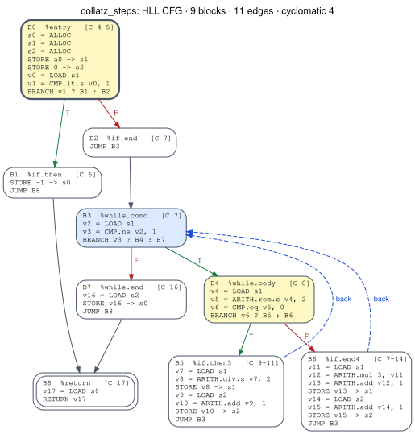

# Part 4: HLL CFG generator

The HLL CFG generator turns a C file, or a `.ll` file, into **one control-flow graph per function**. Each graph is
available in three interchangeable forms: **JSON**, a **NetworkX** graph, and a **Graphviz** diagram. Every
function of every file goes through the **same implementation**. Nothing is special-cased per program or per
construct.

```bash
cfgverify hll-cfg regression/c/*.c examples/c/part3/*.c -o build/hll_cfg --check   # JSON + SVG + index.html
bash scripts/checkpoint_part4.sh                                                   # the Part 4 checkpoint
```

```
C file ──clang -O0 -g──► .ll ──ir_reader (Part 3)──► blocks/terminators ──cfg_builder──► CFG
                                                                                          ├─► JSON   (model/cfg.py, schema model/cfg.schema.json)
                                                                                          ├─► NetworkX MultiDiGraph
                                                                                          └─► Graphviz SVG + HTML gallery (model/cfg_dot.py)
```

| Module | Responsibility |
|---|---|
| `model/ops.py` | The vocabulary of **normalized operations**, shared with the assembly side later |
| `model/cfg.py` | `CFG`, `Node`, `Edge`, `BranchInfo`: analysis, invariants, JSON, NetworkX |
| `model/cfg.schema.json` | JSON Schema `cfgverify.cfg/1` |
| `model/cfg_dot.py` | Graphviz rendering (SVG/PNG/PDF/DOT) and the HTML gallery |
| `hll/ir_ops.py` | IR instruction → normalized operation, with canonical names |
| `hll/cfg_builder.py` | IR function → `CFG` (`cfgs_from_file`, `build_cfgs`, `build_cfg`) |
| `hll/cfg_checks.py` | The checks every generated CFG must pass (§8) |

---

## 1. Nodes

There is exactly **one node per LLVM basic block**, in IR order. No virtual ENTRY/EXIT nodes are added: those belong
to CFG normalization (rule N4), which comes later.

| Field | Meaning | Example (`clamp_negative`, entry block) |
|---|---|---|
| `id` | Block ID, `B<index>`. `B0` is always the entry. It does not depend on names | `B0` |
| `label` | The block's name in the IR | `entry` (or `2` in numbered IR) |
| `index` | Position in the IR | `0` |
| `instructions` | Raw IR instructions: `text`, `.ll` `line`, C `source_line` | `%cmp = icmp slt i32 %1, 0` (line 17, C line 10) |
| `operations` | **Normalized operations**, one per instruction (§2) | `v2 = CMP.lt.s v1, 0` |
| `predecessors` / `successors` | Block IDs | `[]` / `[B1, B2]` |
| `terminator` | `br`, `cond_br`, `ret`, `unreachable`, `switch`, … | `cond_br` |
| `source_lines` | C lines executed in the block (with `-g`) | `[9, 10]` |
| `calls` | Functions called in the block | `[]` |
| `is_entry`, `is_exit` | `is_exit` = the block leaves the function (`ret`, `unreachable`, `resume`) | `true`, `false` |
| `loop_header`, `loop_depth` | From dominator analysis (as in Part 2) | `false`, `0` |

## 2. Normalized operations

Raw instructions depend on naming (`%cmp` vs `%6`), on types (`i32`, `ptr`) and on details that don't matter for
control flow (`align 4`, `nsw`, `!dbg`). A **normalized operation** keeps only *what the instruction does* and
*which values it uses*, with canonical names:

| Canonical name | Meaning |
|---|---|
| `a0, a1, …` | function arguments, by position |
| `s0, s1, …` | stack slots (`alloca`), in order |
| `v0, v1, …` | every other value, in order of definition |
| `B0, B1, …` | blocks, in IR order |
| `@name`, constants | kept as written |

`meta.names` maps every canonical name back to its IR name (`s1 → %y`, `v2 → %cmp`), so nothing is lost.

| Operation | From IR | Example |
|---|---|---|
| `ALLOC` | `alloca` | `s0 = ALLOC` |
| `LOAD`, `STORE` | `load`, `store` | `v0 = LOAD s0`, `STORE v0 -> s1` |
| `ARITH.<k>` | `add sub mul sdiv/udiv srem/urem and or xor shl lshr/ashr fadd … fneg` → `add`, `div.s`, `rem.u`, `shr.s`, `add.f`, … | `v5 = ARITH.rem.s v3, v4` |
| `CMP.<k>` | `icmp`/`fcmp` → `eq ne lt.s le.s gt.s ge.s lt.u …` (`.f` ordered, `.fu` unordered float) | `v2 = CMP.lt.s v1, 0` |
| `CAST.<k>` | `sext zext trunc sitofp …` | `v6 = CAST.sext v3` |
| `ADDR` | `getelementptr` | `v7 = ADDR a1, 0, v6` |
| `CALL.<callee>` | `call` (tail markers and attributes dropped) | `v8 = CALL.square(v1)` |
| `PHI`, `SELECT` | `phi`, `select` | `v11 = PHI v1:B0, 0:B1` |
| `JUMP` / `BRANCH` / `SWITCH` | terminators | `BRANCH v2 ? B1 : B2`, `SWITCH v10, default:B2, 5:B3` |
| `RETURN` / `UNREACHABLE` / `INDIRECT` | `ret`; `unreachable`; `indirectbr invoke callbr resume` and EH | `RETURN v3` |
| `OTHER.<opcode>` | anything else (for example `freeze`). It is kept, never dropped | `v10 = OTHER.freeze v9` |

`call @llvm.dbg.*` debug bookkeeping produces **no** operation. Every other instruction produces **exactly one**; the
checks verify this for every block.

**Why this matters.** The same function in named and numbered IR has different labels but **identical operations,
edges and analysis**. This is tested on every C file in the repo. Later, the assembly side will map instructions onto
the same vocabulary. For example, a compare followed by a conditional jump becomes `CMP` + `BRANCH`, which makes block
contents comparable across the two sides.

> *Operation normalization* (per instruction, this part) is **not** the same as *CFG normalization* (rules N1–N8,
> which rewrite the graph, in a later part).

## 3. Edges

There is one edge per successor slot, in LLVM's order.

| Field | Meaning | Example |
|---|---|---|
| `id` | `E<n>` | `E1` |
| `source`, `destination` | Node IDs | `B0` → `B2` |
| `index` | Successor position. For a 2-way branch, 0 = TRUE target and 1 = FALSE target | `1` |
| `kind` | `T` / `F` / `U` / `default` / `case:<v>` / `normal` / `unwind` / `indirect` / `eh` | `F` |
| `back_edge` | The destination dominates the source (the edge closes a loop) | `false` |
| `branch` | `null` for `U`. Otherwise the branch information below | |

`branch` for the F edge of `clamp_negative`:

```json
{ "taken_when": "v2 is false", "condition": "v2", "compare": "v2 = CMP.lt.s v1, 0", "predicate": "slt",
  "ir": "%cmp = icmp slt i32 %1, 0", "case_value": null, "source_line": 10, "source_text": "if (x < 0)" }
```

For a `switch`, `taken_when` is `v10 == 5` (or `no case matches` for the default) and `case_value` holds the constant.

## 4. Analysis (per CFG)

Here is the `analysis` object for `clamp_negative`:

```json
{"blocks": 3, "edges": 3, "decisions": 1, "cyclomatic": 2, "back_edges": [], "loops": [], "unreachable": [], "unsupported": []}
```

- `loops` lists `{header, depth, body}`, the natural loops from dominators.
- `unreachable` lists blocks that cannot be reached from the entry.
- `unsupported` lists terminator kinds outside the Phase A subset (for example `switch`), so later stages can answer
  UNSUPPORTED instead of guessing.

## 5. The three representations

**JSON:** `cfg.to_json()` / `CFG.from_json()`. The document has these top-level keys:

- `schema` (`"cfgverify.cfg/1"`)
- `function`
- `origin` (`"hll"`; the assembly side will write `"asm"`)
- `entry`
- `exits`
- `meta` (C file, `.ll` file, target triple, lines, generator, `names`)
- `analysis`
- `nodes`
- `edges`

`model/cfg.schema.json` specifies every field. The checks validate each generated file against it with
`jsonschema`, and malformed documents are rejected (tested).

**NetworkX:** `cfg.to_networkx()` returns a `MultiDiGraph`. It is a multigraph because a switch can reach the same
block twice.
- Nodes are keyed by ID, and edges by edge ID.
- Every field is available as an attribute.
- `g.graph` holds `function`, `entry`, `exits`, `meta` and `analysis`.
- `CFG.from_networkx(g)` converts back, and the round trip is exact (checked for every CFG).

```python
from cfgverify.hll.cfg_builder import cfgs_from_file
cfg = cfgs_from_file("examples/c/part3/collatz.c")["collatz_steps"]
g = cfg.to_networkx()
g.nodes["B3"]["loop_header"], g.get_edge_data("B3", "B4")["E4"]["branch"]["compare"]
# (True, 'v3 = CMP.ne v2, 1')
```

**Graphviz:** `cfg_dot.render(cfg, "out.svg", detail="ops" | "ir" | "none")`. The `hll-cfg` command also writes
`index.html`, a gallery of every function's diagram.



The diagram uses these marks:

| Mark | Meaning |
|---|---|
| thick border | entry |
| double border | exit |
| yellow fill | 2-way decision |
| blue fill | loop header |
| green / red edge | T / F |
| grey edge | unconditional |
| dashed blue edge | back edge |

Each node shows its ID, IR label, C lines and normalized operations. In the diagram above, `continue` gives the
loop header `B3` two back edges.

## 6. Command line and API

```bash
cfgverify hll-cfg FILE.c|FILE.ll ... [-o DIR] [-f FUNCTION] [--detail ops|ir|none] [--no-svg]
                  [--no-debug-info] [--target TRIPLE] [--check]
```

The command writes these files to `DIR`:
- `<file>.<function>.cfg.json`
- `<file>.<function>.svg`
- `index.html`
- the `.ll` file generated from each C input

C input is compiled with the canonical flags plus `-g`, so nodes and branches carry C line numbers. The `-g` flag
does not change the CFG (shown in Parts 2 and 3).

## 7. Design decisions

| Decision | Why |
|---|---|
| One node per IR block, and no virtual nodes | The CFG stays 1:1 with LLVM's view and with the Part 2 specs. Virtual EXIT (N4) and other rewrites happen in CFG normalization, where they are logged |
| IDs `B<index>`, with the IR name kept as `label` | IDs are stable and name-independent. Labels keep the evidence readable |
| Canonical value names plus `meta.names` | Operations can be compared across naming schemes, and every one can still be traced back to the IR |
| `OTHER` instead of failing | The generator never loses an instruction and never crashes on valid IR |
| Same JSON schema for HLL and assembly (`origin`) | The matcher will see one data model |

## 8. Verification

Every CFG must pass these checks (`hll/cfg_checks.py`, run by `--check` and the checkpoint):

1. The JSON is valid against the schema.
2. The JSON round trip is exact.
3. The NetworkX round trip is exact.
4. The structural invariants hold:
   - node and edge IDs are consistent;
   - successors and predecessors agree with the edges;
   - successor indices run 0..k-1;
   - a 2-way branch has T then F;
   - exits have no successors;
   - the last operation is a terminator;
   - the LLVM entry has no predecessors.
5. **LLVM agrees:** the edges, by IR label and successor index, equal `opt -passes=dot-cfg`.
6. Every non-debug instruction gives exactly one operation.

The tests (`tests/test_hll_cfg.py`, 106 with the default of 20 random programs per mode) cover:
- **Expected CFGs:** all 16 Part 2 functions (blocks and order, T/F/U edges, exits, back edges, loops and depths,
  decisions, loop headers, predicates, the C line of each branch).
- **Every C file in the repo:** all six checks pass.
- **Naming independence:** named and numbered IR give identical operations, edges and analysis.
- **Unit tests:**
  - normalization of every instruction kind and every integer predicate;
  - the schema rejecting five kinds of malformed documents;
  - the invariants catching a missing edge and swapped T/F;
  - NetworkX attributes;
  - rendering in all three detail modes;
  - the CLI's JSON/SVG/gallery output.
- **Random programs** (supported and extended, at `-O0` and `-O2`): all checks pass.
  - Supported mode also checks that the number of decisions and loops equals the counts known from the source.
  - At `-O0`, supported programs use only `ALLOC LOAD STORE ARITH CMP JUMP BRANCH RETURN`.
  - Extended programs, which add `switch`, `&&`, `||`, `?:` and `goto`, never fall back to `OTHER`.
- **Mutation check:** I planted two bugs on purpose, and the tests caught both.
  - Mapping `slt` to the wrong comparison kind was caught by the predicate test.
  - Swapping T/F on edges made 37 of 70 tests fail (run with 2 random programs per mode).

## 9. Checkpoint result

`bash scripts/checkpoint_part4.sh` processed **16 different C files (27 functions)** with the same implementation.
It printed the checksums of the implementation, and every CFG passed every check:

| Files | Functions | Blocks | Edges | Loops | Result |
|---|---|---|---|---|---|
| 10 regression programs (`regression/c`) | 16 | 1–11 each | 0–13 each | 0–2 each | all checks ok |
| 5 Part 3 programs (`examples/c/part3`) | 7 | 6–13 | 7–16 | 0–2 | all checks ok |
| `examples/c/hello_cfg.c` | 4 | 1–10 | 0–12 | 0–1 | all checks ok |

It then ran the HLL CFG tests with 50 random programs per mode, which are more C files that go through the same
code. To try your own file, run `bash scripts/checkpoint_part4.sh my_file.c`.
